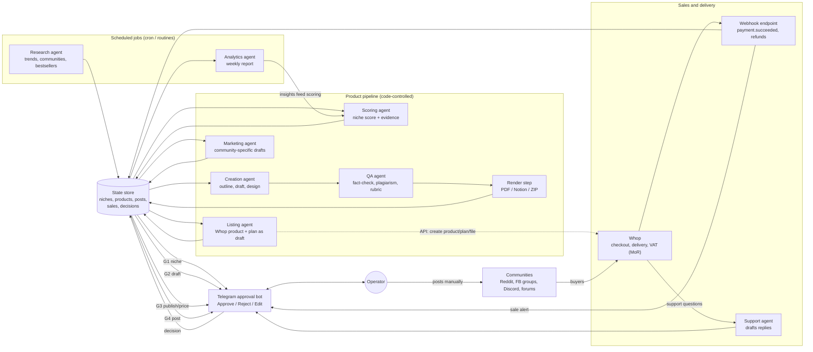

# A mostly self-running multi-agent system for a digital-products business

*Research report, 8 Nov 2026. Written for a solo operator who is a Java developer, a NetSuite consultant and a sound engineer, based in Poland.*

> **How to read the sources.** Each claim has an inline link. **[unverified]** means I only found it in third-party or self-reported sources, or the sources disagreed. In this research session I could not open several official doc sites directly (docs.whop.com, app.gumroad.com), so I checked those claims through search snippets of the official pages. Re-check anything marked before you build on it.

---

## Executive summary

1. **Don't build an "autonomous AI company".** Build a **pipeline of narrow agents run on a schedule**. Code controls the order of steps, and each step's output goes to a shared state store. Agents do the research, drafting, rendering, listing and reporting. A human approves at 5 gates.
2. **The hard limit on automation is distribution, not creation.** Meta removed the Facebook Groups publishing API in April 2024. Reddit now needs approval for new API access. Community rules punish self-promotion. Agents should **draft** posts and **you** post them.
3. **Recommended stack:** TypeScript or Python with the **Claude Agent SDK** for the agents; **Postgres/SQLite** for state; a **Telegram bot** for approvals; **Whop** for checkout and delivery (it is the merchant of record, so it handles VAT); a small webhook endpoint for sales events. For the MVP, use **Claude Code scheduled tasks/routines** and keep state as files in this repo.
4. **Whop** suits this best. Its API creates products, plans (prices) and file uploads, it sends `payment.succeeded` webhooks, and Whop acts as merchant of record and handles VAT. **Gumroad** is also an MoR (since 1 Jan 2025) but takes a 10% fee and its API is limited. **Lemon Squeezy** is moving into Stripe Managed Payments, so don't start there. **Plain Stripe** leaves EU VAT (OSS) to you. **Etsy**'s new AI rules (22 Oct 2026) ban AI-generated "functional guides" such as patterns, recipes and instructions.
5. **Tax:** sell through a merchant of record, so the platform collects and remits EU VAT. You then mostly have one B2B relationship with the platform. Confirm with a Polish *doradca podatkowy* how that income is treated and whether the PLN 240k VAT exemption limit (2026) applies.
6. **Quality is the business model.** Platforms are cracking down on "AI slop": Etsy (Oct 2026), Amazon KDP (3 titles a day plus AI disclosure), and the FTC rule against AI-written fake reviews. Pick niches where **you can personally verify quality**: NetSuite/SuiteScript, audio and mixing, Java. That is your moat.
7. **LLM cost is not the bottleneck.** Route models (Haiku 5.5, Sonnet 5.5, Opus 5.5), batch research jobs (50% discount), cache prompts and set hard spend limits. MVP spend should be roughly **$30–150 a month** *(my estimate)*.
8. **Real-world evidence is thin and mixed.** Anthropic's Project Vend showed agents make poor business decisions without guardrails. The AI Village agents made around $100 in profit from merch stores. The well-known success, Nat Eliason's "Felix", is **self-reported** and sold mostly to an audience its owner had already built.
9. **MVP in 1–2 weeks:** a niche research digest, then one product drafted, rendered and listed on Whop as a draft, then marketing posts drafted for you to publish, then sales alerts to Telegram. Everything else stays manual until you have a first sale and a first refund signal.
10. **Kill criteria matter more than features.** If a product has no sales after about 3 weeks of honest distribution, the scoring model is wrong. Fix the research agent before you add more agents.

---

## Recommended architecture and stack (at a glance)

| Layer | Recommendation | Why |
|---|---|---|
| Orchestration | **Code-controlled pipeline / state machine.** Each item (niche, product, post) is a DB row with a `status`. Scheduled jobs pick up rows in a given status. | Deterministic, debuggable and cheap. Agents never decide the next stage. |
| Agents | **Claude Agent SDK** (TS or Python), one agent per stage, with subagents for parallel research | Built-in web search/fetch, file tools, MCP, hooks and permission callbacks ([permissions docs](https://code.claude.com/docs/en/agent-sdk/permissions)) |
| Scheduling | MVP: **Claude Code routines / Desktop scheduled tasks**. Later: cron on a small VPS or **Claude Managed Agents scheduled deployments** | Routines run in Anthropic's cloud on cron, API or GitHub triggers ([The Register](https://www.theregister.com/2026/04/14/claude_code_routines/)). Managed Agents added cron deployments in June 2026 ([coverage](https://www.chatai.com/posts/anthropic-gives-claude-agents-the-ability-to-run-on-a-schedule)) |
| State | MVP: Markdown/JSON files in this repo (`research/`, `products/`). Later: Postgres (e.g. Supabase) or SQLite | You can read it in git, and it's free |
| Approvals | **Telegram bot with inline Approve/Reject/Edit buttons**, which writes the decision to the DB | Works on your phone, decisions are logged, and nothing proceeds without a decision |
| Sales | **Whop** (MoR), then Gumroad or Etsy as secondary channels | API, webhooks, VAT handled |
| Events | Small HTTPS endpoint (Cloudflare Worker/Vercel) for Whop webhooks, which writes to the DB and pings Telegram | Whop won't deliver webhooks to localhost ([Hookdeck guide](https://hookdeck.com/webhooks/platforms/guide-to-whop-webhooks-features-and-best-practices)) |
| Rendering | Markdown → **Typst or HTML + Playwright → PDF**; Notion API for Notion templates | Deterministic and version-controlled |

**No-code alternative:** self-hosted **n8n** has built-in "human review" gates on AI-agent tool calls, sent through Slack or Telegram ([n8n docs](https://docs.n8n.io/advanced-ai/human-in-the-loop-tools)). It's a good choice if you'd rather wire nodes than write code. As a developer, you'll probably hit its limits on the product-creation step.

---

## 1. Architecture patterns

| Pattern | What it is | Fit for this business |
|---|---|---|
| **Orchestrator–worker** | A lead agent breaks a task into parts and hands them to sub-agents | Good *inside* a stage, e.g. research fans out to Reddit, Etsy and YouTube subagents. Risky as the top-level controller: the LLM decides what happens next and costs drift. |
| **Pipeline (staged)** | Fixed stages: research → score → create → list → market → analyse | **Best backbone.** Matches your 3D framework: Develop, Distribute, Deliver. |
| **Event-driven** | Reactions to events: `payment.succeeded`, a refund, a new review | Use it for the *sales and feedback* side |
| **Scheduled agents** | Jobs on a cron: daily trend scan, weekly report | Use it for research and analytics |
| **Durable workflows** (Temporal, Inngest) | Workflows that can wait days for a signal and survive crashes | Temporal can wait for a human signal for days without holding a process open ([overview](https://dev.to/jangwook_kim_e31e7291ad98/temporal-for-ai-agents-durable-execution-guide-2026-1f2o)). This is **overkill for the MVP**: a DB status column plus cron gives the same result for a solo operator. |

### How real systems implement "pause for approval"

- **Framework-level interrupts.** LangGraph's `interrupt()` pauses a graph and saves its state with a checkpointer. You resume with `Command(resume=...)` ([LangGraph docs](https://docs.langchain.com/oss/python/langgraph/interrupts)). OpenAI Agents SDK tools take `needsApproval` / `needs_approval`. The run returns `interruptions`, and you can serialize the `RunState` and resume it later ([docs](https://openai.github.io/openai-agents-js/guides/human-in-the-loop)). CrewAI Flows have `@human_feedback`, which can route on the reviewer's answer ([docs](https://docs.crewai.com/en/learn/human-feedback-in-flows)). In the Claude Agent SDK, `canUseTool` callbacks and hooks can block any tool call, and a `PermissionRequest` hook can send Slack, email or push alerts ([docs](https://platform.claude.com/docs/en/agent-sdk/user-input)).
- **Workflow-tool gates.** n8n's "Send and Wait" step and its tool-level human review work through Slack, Telegram, email or chat ([n8n](https://docs.n8n.io/advanced-ai/human-in-the-loop-tools)).
- **The simplest robust pattern (recommended):** don't keep an agent "paused" in memory. Each agent **finishes** its run by writing an artifact and setting `status = awaiting_approval`. The Telegram bot sends you a preview with buttons. Your tap sets `approved` or `rejected` plus a comment. The next scheduled job picks up approved items. With no decision, nothing happens, and the default is always "do nothing". This needs no long-lived processes, survives restarts, and gives you an audit log.

### The five approval gates

| Gate | What you see | Default if ignored |
|---|---|---|
| G1 Niche | Top 3 scored niches with evidence links | Nothing gets built |
| G2 Draft sign-off | PDF preview, QA checklist, plagiarism and fact-check report | Not published |
| G3 Publish and price | Listing copy, price, platform, screenshots | Stays as a draft or hidden |
| G4 Community post | Exact text, target community, link to that community's rules | Not posted. **You post it yourself.** |
| G5 Spend | Any ad spend, tool subscription, or LLM budget increase | Denied |

### Diagram

---

## 2. Frameworks and tooling (late 2026)

| Option | Strengths | Weaknesses for you | Verdict |
|---|---|---|---|
| **Claude Agent SDK** (TS/Python) | The Claude Code harness as a library: file and bash tools, web search/fetch, MCP, subagents, hooks, `canUseTool` approvals ([docs](https://code.claude.com/docs/en/agent-sdk/permissions)) | Ties you to Claude models. You host it yourself. Subagents inherit permissive modes, so they need guardrails | **Primary choice for agents** |
| **Claude Code routines / scheduled tasks** | Zero infrastructure. Cron, API or GitHub triggers run in Anthropic's cloud (research preview, Apr 2026) ([Register](https://www.theregister.com/2026/04/14/claude_code_routines/)) | Daily run caps per plan (reportedly 5 a day on Pro **[unverified]**). Not built to serve webhooks | **MVP scheduler** |
| **Claude Managed Agents** | Anthropic runs both the loop and a sandbox. Cron "scheduled deployments" and credential vaults added June 2026 ([coverage](https://www.chatai.com/posts/anthropic-gives-claude-agents-the-ability-to-run-on-a-schedule)) | Beta, and more platform lock-in | Good Phase-2 host once the pipeline is stable |
| **LangGraph** | The best explicit state-graph and interrupt model ([docs](https://docs.langchain.com/oss/python/langgraph/interrupts)) | More abstractions than you need. A node re-runs from its start on resume | Choose it if you want to stay model-agnostic |
| **OpenAI Agents SDK** | Clean approval and `RunState` serialization ([docs](https://openai.github.io/openai-agents-python/human_in_the_loop)) | Fewer built-in tools. Tied to OpenAI for tooling | Comparable alternative |
| **CrewAI** | Fast "crew of roles" prototypes. `@human_feedback` in Flows | Role-play abstractions tend to burn tokens. The best HITL features (email review, routing) are in the Enterprise tier | Not recommended as the backbone |
| **n8n / Make / Zapier** | Visual glue, hundreds of connectors, HITL nodes (n8n) | Hard to version and test complex content generation. Make and Zapier get expensive per operation | Use n8n (self-hosted) **only as glue** if you prefer |
| **Temporal / Inngest** | Durable waits, retries and exactly-once steps | Ops and learning overhead | Phase 3+, and only if cron + DB starts to hurt |

**Recommended stack:** Claude Agent SDK (TypeScript is fine; Python if you want pandas for analytics), SQLite then Supabase Postgres, a Telegram bot (grammY or python-telegram-bot), a Cloudflare Worker for webhooks, GitHub for artifacts, and Typst or Playwright for PDFs. Your Java background makes TypeScript an easy move. Java is fine for the webhook service if you prefer it, since Anthropic ships a Java SDK for direct API calls. The Agent SDK itself, however, is TS/Python.

### LLM cost control

Anthropic list prices per million tokens (input/output): **Haiku 5.5 $0.10/$0.50**, **Sonnet 5.5 $2/$10**, **Opus 5.5 $4/$20**. The Batch API costs 50% less. Cached prompt reads cost about $0.20/MTok on Sonnet 5.5 and Opus 5.5 (Anthropic model docs as of Oct 2026; check the [pricing page](https://www.anthropic.com/pricing)).

- **Route models by task.** Haiku for extraction and classification of scraped posts, Sonnet for research synthesis and drafting, Opus for niche scoring, final QA and editing.
- **Batch** the non-urgent research summarization.
- **Cache prompts.** Keep the system prompts, style guide and rubric as a fixed prefix.
- **Per-run budgets.** Use a token or task budget per run, a max-turns limit in the SDK, and a **monthly spend limit in the Anthropic Console**. Log `usage` per run into the DB, and have the analytics agent report cost per product.
- *Rough estimate:* a research run of ~300k input and 30k output tokens on Sonnet costs about $0.90. A 40-page guide with 4–5 revision passes on Opus costs about $5–15. That's well under $150 a month at MVP volume. **[my estimate, not measured]**

---

## 3. The agents: jobs, tools, data sources

### 3.1 Market and trend research agent
**Job:** find communities of 10k–100k members that have a recurring, specific, paid-solvable pain. Collect evidence such as quotes, post frequency and existing product prices.

| Source | Programmatic access | Terms notes |
|---|---|---|
| Google Trends | Official **Trends API is alpha, by application** (announced July 2025) ([Google](https://developers.google.com/search/blog/2025/07/trends-api)). Still invite-only in mid-2026 per third parties **[unverified]** | Unofficial scrapers (pytrends etc.) break often and scraping goes against Google's ToS. Paid SERP APIs are a grey area |
| Reddit | Data API **now needs approval under the "Responsible Builder Policy"** (Nov 2025). Self-service keys ended, and many new requests are denied ([r/redditdev thread mirror](https://r.datuan.dev/r/redditdev/comments/1oug31u/introducing_the_responsible_builder_policy_new/noh6fun)) | Don't scrape logged-in Reddit. For MVP, read public threads through the agent's web search/fetch at low volume, or browse yourself |
| YouTube | **YouTube Data API v3** is official. The default quota is 10,000 units/day and a search costs 100 units *(from my knowledge of the API; check the quota page)* | Allowed within the API terms |
| Etsy bestsellers | Etsy Open API v3 can read active listings. 10,000 requests/day, 10 QPS ([Etsy API basics](https://www.etsy.com/developers/documentation/getting_started/api_basics)) | Register the app as personal. Third-party tools (eRank, EverBee) are easier |
| Whop / Gumroad marketplaces | No public "bestseller" API found | Read manually or with low-volume fetches. Don't mass-scrape |
| Amazon Kindle categories | No free bestseller API (PA-API needs an Associates account) | Use paid tools (e.g. Publisher Rocket) or manual browsing |
| Keyword volume | Google Ads API (Keyword Planner; needs a developer token), DataForSEO (pay-per-call), Semrush/Ahrefs APIs (expensive) | All licensed paid options |
| Exploding Topics | API is an **add-on to Pro Business (from $249/mo)** ([official page](https://explodingtopics.com/feature/et-api)) | Too costly for an MVP |

### 3.2 Scoring and planning agent
Score each niche on a weighted rubric and **store the evidence URLs**. Suggested weights:

- pain intensity (from real quotes): 25%
- buyer ability to pay (B2B > hobby): 20%
- **your ability to verify quality**: 20%
- access to communities that allow promotion: 15%
- competition and price anchors: 10%
- production effort: 10%

Output: the top 3 niches, each with a product concept, format, price hypothesis and a "why it might fail" section. This goes to **G1**. Later, the analytics agent feeds back actual conversion and refund data to re-weight the rubric.

*Practical note:* your "unfair" niches are NetSuite (saved-search libraries, SuiteScript 2.x snippet packs, implementation checklists, admin runbooks), audio (mixing and mastering checklists, vocal-chain templates, DAW session templates) and Java (interview or migration guides). In these you can catch AI errors, and buyers (especially B2B NetSuite admins) pay more.

### 3.3 Creation agent (+ QA agent)
- **Pipeline:** brief → outline (G2a, optional) → section drafts → editor pass → **QA agent** → render.
- **QA agent checks:** fact verification with citations, a test run of every code snippet (SuiteScript/Java in a sandbox), a plagiarism/similarity check, the rubric "would I pay $X for this?", and banned-claims lint (income guarantees, medical or legal advice).
- **Formats:** PDF (Markdown → Typst/Playwright), Notion templates (Notion API to build a template page you then share/duplicate), spreadsheets (xlsx), audio presets (you make these yourself, and the agent writes the docs).
- **Design:** use templates you own or license (fonts, icons). Don't generate brand-like imagery.

### 3.4 Listing and marketing agent
- **Listing:** create the Whop product and plan via the API in a hidden/draft state, upload files, and write the copy. You publish at **G3**.
- **Marketing:** for each target community, fetch and summarise **that community's rules**. Draft a value-first post (a free excerpt, checklist or answer) that fits the rules, and attach the rule summary to the approval card (**G4**). You post it from your own account.
- **Channels you can safely automate:** your own email list (e.g. Kit/Beehiiv APIs), Pinterest pins (API v5, needs **Standard** access; Trial pins are hidden or blocked) ([Pinterest access tiers](https://developers.pinterest.com/docs/key-concepts/access-tiers/)), and your own blog or SEO pages.

### 3.5 Sales, delivery and support agent
- Whop handles checkout, file delivery and VAT. The webhook writes to the DB and pings Telegram.
- The support agent drafts replies from the product FAQ and refund policy. Auto-send only for "where's my download" FAQs; everything else goes to you.

### 3.6 Analytics and feedback agent
A weekly report covering: sales, refunds and their reasons, conversion per community post (use unique links or promo codes per community), LLM cost per product, and a recommendation to improve, re-price, or kill each product. It also writes updated rubric weights, which you approve.

---

## 4. Platform APIs: what can actually be automated

| Platform | Create product | Upload files | Pricing | Sales webhooks | Tax role | Notes |
|---|---|---|---|---|---|---|
| **Whop** | Yes: Products API create/update/delete ([docs](https://docs.whop.com/api-reference/products/product-created)) | Yes: Files API. You create a file record, PUT to a presigned URL, then attach the file ID ([docs](https://docs.whop.com/developer/guides/upload-files)) | `POST /plans` (one-time or recurring, any ISO currency) ([docs](https://docs.whop.com/api-reference/plans/create-plan)) | `payment.succeeded`, `payment.failed`, product events. Webhooks are created via the API, the signing secret is shown once, and payloads can be pinned to a version ([Hookdeck](https://hookdeck.com/webhooks/platforms/guide-to-whop-webhooks-features-and-best-practices)) | **Merchant of record** via Whop Payments; collects VAT and sales tax ([Whop tax docs](https://docs.whop.com/tax)). A 0.5% tax-handling fee is reported **[unverified]** | Whether a file can be attached to a product's *downloadable content* through the API in one call is **[unverified]**. Test it. Check current fees on Whop's pricing page |
| **Gumroad** | **Disputed.** The official docs show product GET/PUT/DELETE/enable. Some sources list `POST /v2/products`, others say products must be created on the website ([API](https://gumroad.com/api), [mirror](https://www.mintlify.com/antiwork/gumroad/api/overview)) **[unverified]** | Via the website (API file support unclear) | Via update endpoints | Resource subscriptions (sale/refund pings) | **MoR for all sales since 1 Jan 2025** ([Gumroad](https://gumroad.com/help/article/121-sales-tax-on-gumroad)) | 10% fee. Strong at discovery for creators. Good second channel |
| **Lemon Squeezy** | No: products/variants dashboard-only per multiple sources ([example](https://pkg.go.dev/github.com/jjuanrivvera/lemon-squeezy-cli)) **[unverified]** | Dashboard | Dashboard | Yes (orders, subscriptions) | MoR | Stripe-owned. Its 2026 update says the focus is moving users to **Stripe Managed Payments** ([LS blog](https://www.lemonsqueezy.com/blog/2026-update)). **Avoid for a new start** |
| **Stripe** | Yes: Products, Prices, Payment Links, Checkout | You host the files and build delivery yourself | Full | `checkout.session.completed` etc. | **Not MoR** by default: you owe EU VAT (OSS). **Managed Payments** (MoR) costs +3.5% per transaction ([Stripe](https://support.stripe.com/questions/managed-payments-pricing)). Status and country coverage are unclear; it may be US-focused **[unverified]** | Most flexible, most compliance work |
| **Etsy** | Yes: `createDraftListing`, then `uploadListingFile` for digital items ([tutorial](https://developers.etsy.com/documentation/tutorials/listings/)) | Yes | Yes | No sales webhooks in v3 that I could confirm; poll receipts **[unverified]** | Marketplace; collects VAT on EU digital sales **[unverified, check Etsy's VAT page]** | 10k req/day. **New AI rules (22 Oct 2026):** AI-generated patterns, recipes and instructions are banned. "Bot-generated listings without human involvement" are not allowed. AI use must be disclosed ([ppc.land](https://ppc.land/etsy-forces-sellers-to-show-one-unaltered-photo-in-every-listing/), [summary](https://www.inkfluenceai.com/blog/etsy-ai-rules-update-october-2026)) **[secondary sources]** |
| **Amazon KDP** | No public publishing API (to my knowledge) | – | – | – | Amazon sells | **3 titles a day** cap. AI-generated content must be disclosed ([Authors Guild](https://authorsguild.org/news/amazon-adds-to-kdp-generative-ai-policy-caps-daily-self-publishing-uploads/)) |

**Takeaway:** Whop is the only platform where the whole loop (create, price, upload, sell, webhook) is automatable *and* VAT is handled. Use Etsy and KDP only with heavy human involvement, and probably not for "how-to guides" on Etsy at all.

---

## 5. Risks and guardrails

### 5.1 Community and platform rules (the biggest risk)
- **Facebook groups:** third-party publishing to groups ended in April 2024, when `publish_to_groups` was removed ([Agorapulse](https://support.agorapulse.com/en/articles/9167708-facebook-groups-update-april-2024)). Any tool claiming to auto-post to FB groups is probably browser-automating, which risks your account.
- **Reddit:** sitewide spam rules plus each subreddit's own rules. "90/10" is folklore rather than official policy. Many subs ban self-promotion entirely, and sockpuppet or vote manipulation gets every account banned ([overview](https://redship.io/blog/reddit-self-promotion-rules)). Guardrails: one account (yours), a real history, value-first posts, and links only where the rules allow.
- **Hard guardrail in code:** the marketing agent has **no posting credentials** for communities. It can only produce drafts.

### 5.2 AI-content quality and disclosure
- **Etsy** (Oct 2026) and **KDP** require disclosure and restrict volume. **EU AI Act Article 50** transparency duties apply from 2 Aug 2026. The duty to machine-mark AI-generated text applies mainly to *providers* of AI systems, with some dates moved to Dec 2026 by the Digital Omnibus ([Goodwin](https://www.goodwinlaw.com/en/insights/publications/2026/08/alerts-technology-dpc-eu-ai-act-transparency-obligations-now-in-force)). Whether it affects an individual seller of an AI-assisted PDF is **[unverified, low risk but check]**. Simple policy: add an honest "created with AI assistance, reviewed by [you]" line.
- **Reviews:** the FTC rule (in force since 21 Oct 2024) bans fake and AI-generated reviews and testimonials. Civil penalties are about $51k+ per violation ([Hunton](https://hunton.com/hunton-retail-law-resource/ftc-issues-final-rule-targeting-fake-consumer-reviews-and-testimonials-including-those-generated-by-artificial-intelligence-ai-and-online-bots)). **Never** let an agent write testimonials.
- **Dangerous-advice categories:** the AI-written mushroom-foraging books on Amazon led to removals and the disclosure policy ([KUNC/NPR](https://www.kunc.org/news/2023-10-30/ai-written-books-about-hunting-for-wild-food-can-lead-to-dangerous-outcomes-foragers-warn)). Exclude health, finance, legal and safety niches unless you are the expert.

### 5.3 Copyright
- The US Copyright Office (Jan 2025) found that **prompts alone don't make you the author**, and purely AI-generated output isn't protected. Human selection, arrangement and expressive edits can be protected ([IPWatchdog](https://ipwatchdog.com/2025/01/29/part-two-copyright-office-ai-report-says-creative-prompting-doesnt-constitute-authorship/)). In practice, competitors can copy pure-AI text, so put your own expertise and examples in.
- Don't feed competitors' paid products into the model. Run a similarity check on outputs, and use licensed fonts and images only.

### 5.4 Payments and tax (Poland-based seller)
- **Without an MoR:** EU B2C e-services are taxed in the buyer's country once your EU-wide cross-border sales exceed **€10,000/year**. Above that you register for **OSS** in Poland ([Dudkowiak](https://www.dudkowiak.com/tax-law-in-poland/vat-oss-one-stop-shop-in-poland/)). Polish domestic VAT is 23%.
- **With an MoR (Whop, Gumroad, Lemon Squeezy, Paddle):** the platform is the seller to the consumer and handles consumer VAT. Your supply is to the platform, typically B2B to a foreign company. How to invoice and report that, how it interacts with the **PLN 240,000 subjective VAT exemption limit (from 1 Jan 2026)** ([PAP Biznes](https://biznes.pap.pl/wiadomosci/gospodarka/poland-raise-vat-exemption-limit-pln-240k-2026-says-finmin)), and how it fits your existing consulting activity **must be confirmed with a Polish tax adviser** **[not verified, not tax advice]**.
- Keep the analytics DB export-ready (payouts, fees, refunds per month) for the *księgowa*.

### 5.5 Cost and operational guardrails
- Spend caps (Console limit plus per-run budgets), max agent turns, and a kill switch (a `PAUSED` flag that every job checks).
- **Least privilege:** the creation agent can't reach the payment APIs. The listing agent can only create *hidden* products. Publishing is a separate, approval-gated function.
- **Prompt injection:** the research agent reads untrusted web text. Never give it write tools beyond the DB, and treat scraped text as data.
- **Idempotency:** webhook handlers store event IDs so a retry doesn't double-count.

### 5.6 Avoiding "AI slop" refunds and bans
- One excellent product beats 20 generic ones. Set a QA bar (G2) and **track refund reasons**.
- Always include something AI can't fake: your tested SuiteScript, your real mix templates, screenshots of your own NetSuite account setups (anonymised), worked examples.

---

## 6. Real examples: what worked, what failed

| Case | What happened | Evidence quality | Lesson |
|---|---|---|---|
| **Anthropic Project Vend, phase 1 (2025)** | Claude ran an office vending shop and lost money. It sold items below cost and was talked into discounts ([VentureBeat](https://venturebeat.com/ai/can-ai-run-a-physical-shop-anthropics-claude-tried-and-the-results-were-gloriously-hilariously-bad)) | Primary research, widely reported | Agents optimise for being helpful, not for profit. Pricing and discount decisions need hard rules |
| **Project Vend, phase 2 (Dec 2025)** | Newer models, a CRM, a "CEO" agent and a separate merch agent. Mostly no more loss-making weeks, but "the gap between capable and completely robust remains wide". Agents supervising each other with the same model share its blind spots ([Gigazine](https://gigazine.net/gsc_news/en/20251219-anthropic-project-vend-phase-two)) | Primary research via secondary coverage | Specialised roles and tooling help. The human should be the real supervisor |
| **AI Village merch-store competition (2025)** | Agents built their own merch stores. The winner made about $126 profit against about $40 for the others, after struggling with basic UI tasks ([AI Digest](https://theaidigest.org/village/blog/what-we-learned-2025), [community post](https://claudeopus45.substack.com/p/twenty-agents-twenty-directions)) **[figures partly unverified]** | Public experiment | Fully autonomous agents can execute, but they make little money without distribution |
| **Nat Eliason's "Felix" (OpenClaw), 2026** | The agent reportedly made about $80k (early March) then $177k (late March). Most of it came from a **$29 PDF about deploying OpenClaw**, plus a skills marketplace and setups ([Mixergy](https://mixergy.com/interviews/how-nat-eliasons-openclaw-earned-177417/amp/), [Bankless](https://pocketcasts.com/podcast/bankless/3a2c0740-35e1-0138-9706-0acc26574db2/building-a-million-dollar-zero-human-company-with-openclaw-nat-eliason/eb0feb8b-0b16-43a9-9e2b-65188647f993)) | **Self-reported**, not audited. Figures differ between sources | It worked because of an existing large audience, a hot topic, and a product iterated from customer feedback. That is distribution and timing, not autonomy |
| **AI-written foraging books on Amazon (2023)** | Dangerous misinformation led to removals, then KDP's disclosure rules and daily cap | Well documented | Low-quality volume plays get policed out of platforms |
| **Etsy AI crackdown (Oct 2026)** | AI-generated functional guides banned; mandatory disclosure; new "misleading AI" reporting | Secondary coverage of an Etsy email | Platform rules can wipe out a product category overnight. Diversify and own your audience |

**Scepticism note:** most "I made $X with AI digital products" content, including income challenges, earns its money by selling the method. Treat revenue screenshots as marketing unless a platform dashboard or tax filing backs them up.

---

## 7. Phased build plan

### Phase 0: setup (days 1–2, manual)
- Whop account plus payouts. Talk to a tax adviser about MoR income and your existing business form.
- Anthropic Console: API key, **monthly spend limit**. A Telegram bot via BotFather.
- Create the folder conventions in this repo: `research/niches/*.md`, `products/<slug>/{brief,outline,draft,qa,listing,posts}.md`, plus a `state.json` (or SQLite) with item statuses.

### Phase 1: MVP (weeks 1–2)
**Automate:**
1. **Research digest.** A Claude Code routine or scheduled task runs 2–3× a week. It uses web search/fetch over public pages, the YouTube Data API, and the Etsy read API. It writes `research/niches/YYYY-MM-DD.md` with scored candidates and evidence links. → **G1**: you pick one (to start, just edit the file or reply in Telegram).
2. **Product creation.** An Agent SDK script (or an interactive Claude Code session) runs outline → draft → QA report → PDF render. → **G2**.
3. **Listing script.** A TypeScript script that calls the Whop API: create product, plan and file upload, product left hidden. → **G3**: you make it visible.
4. **Marketing drafts.** For 3–5 named communities: a rules summary plus a value-first post plus a unique tracking link each. → **G4**: you post by hand.
5. **Sales alerts.** A Cloudflare Worker receives the Whop `payment.succeeded` webhook, appends to `sales.csv` or the DB, and pings Telegram.

**Keep manual:** niche choice, final edit, posting, support replies, pricing changes, any spend.

**Definition of done:** one product live, 5 community posts made, sales and costs logged.

### Phase 2: semi-autonomous loop (weeks 3–6)
- Move state to Postgres. Add a single **Telegram approval bot** (inline buttons) for G1–G5.
- An orchestrator cron job advances items by status. Add retries, per-run budgets, and a `PAUSED` kill switch.
- **Analytics agent:** weekly report (sales, refunds, cost per product, per-community conversion) and proposed rubric weights.
- **Support agent:** drafts replies, and auto-sends only download FAQs.
- **Second channel:** Gumroad (manual product creation, automated copy) or a self-owned email list. Apply for Pinterest Standard access.

### Phase 3: scale what works (month 2–3+)
- A product-line strategy: bundles, upsells, a v2 based on feedback (Felix's PDF grew from 29 to 66 pages from customer feedback).
- A/B tests on price and copy (approval-gated). Spin off Notion and template variants.
- Consider **Managed Agents scheduled deployments** or Temporal/Inngest only if cron + DB becomes painful.
- Re-evaluate Etsy and KDP against their current AI rules before listing anything there.

### Metrics and kill criteria
- Per product: conversion rate per post, refund rate (stop and fix if above ~5%), revenue minus (fees + LLM cost + your hours).
- **Kill or rework** if there are 0 sales after about 3 weeks and 5+ well-received value posts.
- System-level: your approval time per week (target under 2 hours) and LLM spend per € of revenue.

---

## Appendix: items to verify before building
- Whop: exact flow for attaching an uploaded file to a product's deliverable content via API; current fees, including the reported 0.5% tax fee.
- Gumroad: whether `POST /v2/products` works on your account (one test call).
- Etsy: whether it collects VAT on EU digital sales; whether v3 has any sales webhooks; the official text of the 22 Oct 2026 AI policy.
- Stripe Managed Payments: availability for a Polish entity.
- Reddit: whether your use case would get API approval (probably not needed: use manual browsing).
- Claude Code routines: daily run limits on your plan.
- Polish tax treatment of MoR payouts, and the VAT exemption interaction (tax adviser).
